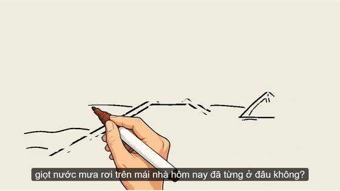
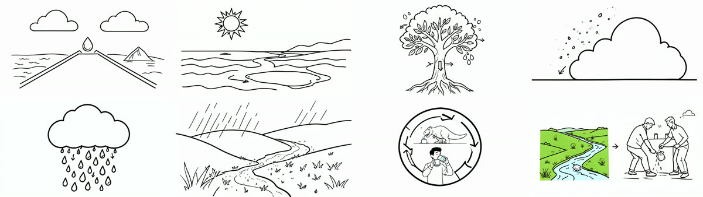

# Video Studio Local

Nhập **kịch bản tiếng Việt** → nhận về **video vẽ bảng (whiteboard animation)** hoàn chỉnh: có giọng đọc,
phụ đề, màn hình tiêu đề, chuyển cảnh và nhạc nền.
Chạy **hoàn toàn offline** trên một máy Windows có GPU NVIDIA 8GB — không dùng API trả phí.



| Màn hình tiêu đề | Storyboard do AI vẽ (8 cảnh) |
|---|---|
|  |  |

## Tính năng

- **Chia cảnh bằng AI** — LLM chạy local đọc kịch bản, chia thành cảnh 8–20 giây, viết mô tả ảnh cho từng cảnh
  (lời đọc giữ nguyên văn). Kịch bản dài được chia nhiều phần để không vượt ngữ cảnh.
- **Vẽ ảnh** từng cảnh theo phong cách nét vẽ bảng (FLUX.2 [klein] 4B, bản 4-bit — chỉ ~2.8GB VRAM).
- **Giọng đọc tiếng Việt** tự nhiên, 25 giọng mẫu, chạy trên CPU (VieNeu-TTS).
- **Animation vẽ bảng**: bàn tay vẽ từng nét rồi tô màu; tuỳ chọn vẽ **theo vùng khớp từng câu đang đọc**.
- **Ghép video bằng Remotion**: tiêu đề viết tay, chuyển cảnh mờ dần, phụ đề, **nhạc nền tự nhỏ lại khi có giọng đọc**.
  Xuất kèm file phụ đề `.srt`.
- **Giao diện web 4 bước** (Kịch bản → Storyboard → Giọng đọc → Xuất video): sửa lời đọc / mô tả ảnh,
  thêm / xoá / đổi thứ tự cảnh, **tạo lại từng cảnh**, xem tiến độ.
- **Theo dõi phụ thuộc**: sửa lời đọc thì chỉ audio cảnh đó "cần tạo lại", sửa mô tả thì chỉ ảnh cảnh đó —
  không bao giờ phải chạy lại cả video.
- **An toàn VRAM**: mỗi tác vụ GPU chạy trong một tiến trình riêng, xong là trả sạch VRAM; tác vụ GPU (ảnh) và
  CPU (giọng đọc, xuất video) chạy song song; tắt app mở lại vẫn làm tiếp được.

## Cách hoạt động

| Bước | Việc | Model / công cụ | Chạy trên |
|---|---|---|---|
| 1 | Chia kịch bản thành cảnh + viết mô tả ảnh | [Qwen3.6-35B-A3B](https://huggingface.co/unsloth/Qwen3.6-35B-A3B-GGUF) qua Ollama | GPU + RAM |
| 2 | Vẽ ảnh từng cảnh | [FLUX.2 [klein] 4B NF4](https://huggingface.co/hlhc/FLUX.2-klein-4B-bnb-4bit) (diffusers) | GPU |
| 3 | Giọng đọc | [VieNeu-TTS v3 Turbo](https://github.com/pnnbao97/VieNeu-TTS) (ONNX) | CPU |
| 4a | Animation vẽ bảng từng cảnh | [whiteboard-stream-animation](https://github.com/geeklee/whiteboard-stream-animation) / [srt-whiteboard-animation](https://github.com/geeklee/srt-whiteboard-animation) | CPU |
| 4b | Ghép tiêu đề, chuyển cảnh, giọng, phụ đề, nhạc | [Remotion](https://www.remotion.dev) (hoặc ffmpeg) | CPU |

Ví dụ thực tế: kịch bản 540 tiếng → video 2 phút 10 giây, 8 cảnh, mất khoảng **6 phút** trên i5-12400F + RTX 5060 8GB.

## Yêu cầu

- **Windows 10/11**, GPU NVIDIA **8GB VRAM** trở lên (đã thử trên RTX 5060), **32GB RAM** (LLM để phần lớn trên RAM)
- ~**35GB** ổ trống cho model (Qwen ~23GB, FLUX ~4.8GB, VieNeu ~0.7GB, Remotion ~0.5GB)
- [Python 3.12](https://www.python.org), [Node.js 20+](https://nodejs.org), [Git](https://git-scm.com),
  [ffmpeg](https://ffmpeg.org) trong PATH (bản có libass để chèn phụ đề), [Ollama](https://ollama.com), driver NVIDIA mới

## Cài đặt

> Nên đặt biến môi trường `HF_HOME` (cache model Hugging Face) và thư mục model của Ollama
> (Ollama → Settings → Model location) sang ổ còn nhiều chỗ trống trước khi cài.

```bat
git clone <url-repo-này> video-studio-local
cd video-studio-local

:: 1. Python + PyTorch (lấy lệnh đúng bản CUDA của bạn ở pytorch.org; RTX 50-series cần CUDA 12.8+)
python -m venv .venv
.venv\Scripts\pip install torch torchvision --index-url https://download.pytorch.org/whl/cu130
.venv\Scripts\pip install -r requirements.txt
.venv\Scripts\python check_env.py

:: 2. Hai repo vẽ bảng (dùng chung một venv riêng)
git clone --depth 1 https://github.com/geeklee/whiteboard-stream-animation third_party\whiteboard-stream-animation
git clone --depth 1 https://github.com/geeklee/srt-whiteboard-animation  third_party\srt-whiteboard-animation
python third_party\whiteboard-stream-animation\scripts\prepare_env.py

:: 3. LLM chia cảnh (~23GB)
ollama pull hf.co/unsloth/Qwen3.6-35B-A3B-GGUF:UD-Q4_K_M

:: 4. Remotion (~510MB: node_modules + Chrome Headless Shell). Bỏ qua thì app tự ghép bằng ffmpeg.
cd remotion && npm install && npx remotion browser ensure && cd ..
```

**Lần chạy đầu** FLUX (~4.8GB) và VieNeu (~0.7GB) tự tải về `HF_HOME`. Từ lần sau app tự chuyển sang chạy
offline (`hf_offline: auto` trong `config.yaml`) nên nạp model nhanh hơn và không cần mạng.

## Sử dụng

Bấm đúp **`start.bat`** trong File Explorer → server chạy và trình duyệt mở http://127.0.0.1:8000.
(Ứng dụng Ollama phải đang chạy để dùng "Chia cảnh bằng AI".)

1. **Kịch bản** — dán lời thoại → "✨ Chia cảnh bằng AI" (1–2 phút) hoặc "Chia theo đoạn văn".
   Sửa lời đọc / mô tả ảnh, thêm / xoá / đổi thứ tự cảnh → **Lưu thay đổi**.
2. **Storyboard** — "Tạo các ảnh còn thiếu". Ảnh chưa ưng: sửa mô tả (tự lưu) → "↻ Tạo lại".
3. **Giọng đọc** — chọn giọng → "Tạo audio còn thiếu". Bước 2 và 3 chạy song song được.
4. **Xuất video** — bật/tắt tiêu đề, phụ đề; chọn **nhạc nền** (mp3/wav/m4a…, âm lượng, tự giảm khi có giọng)
   → "Xuất video" → xem, tải `.mp4` và `.srt`.

Trạng thái mỗi phần: *Chưa có · Sẵn sàng · Cần tạo lại · Lỗi*. Bấm vào "x/N" trên thanh bước để nhảy tới cảnh còn thiếu.

**Dòng lệnh** (không cần giao diện):

```bat
.venv\Scripts\python run_pipeline.py kich_ban.txt                                 :: cả quy trình → outputs\<id>\final.mp4
.venv\Scripts\python run_pipeline.py kich_ban.txt --no-llm --placeholder-images   :: thử nhanh, không cần GPU
.venv\Scripts\python run_pipeline.py --project-id <id>                            :: chạy tiếp dự án dở
```

## Cấu hình — `config.yaml`

| Mục | Ý nghĩa |
|---|---|
| `scenes.min_sec / max_sec` | Độ dài mong muốn mỗi cảnh (mặc định 8–20 giây) |
| `llm.model`, `llm.chunk_words` | Model Ollama chia cảnh (đổi sang model nhỏ hơn nếu chậm); kịch bản dài chia từng phần ~600 tiếng |
| `llm.use_mmap` | Giữ `true` trên Windows — không thì Ollama có thể lỗi `failed to allocate CUDA_Host buffer` |
| `images.cpu_offload` | `true`: ~2.8GB VRAM, và trên card 8GB còn *nhanh hơn* để cả model trên GPU |
| `tts.voice`, `tts.precision` | Giọng mặc định; `int8` nhanh hơn, `fp32` chất lượng tối đa |
| `whiteboard.engine` | `stream`: vẽ cả ảnh một lượt · `regions`: vẽ từng vùng khớp từng câu (chậm hơn ~3 lần) |
| `render.engine` | `remotion`: tiêu đề, chuyển cảnh, phụ đề, nhạc nền · `ffmpeg`: ghép thẳng, rất nhanh |
| `remotion.*`, `subtitles.*`, `music.*` | Font/thời lượng tiêu đề, chuyển cảnh; cỡ chữ phụ đề; âm lượng và ducking nhạc nền |
| `hf_offline` | `auto` (mặc định): offline khi model đã có trong cache, online để tải ở lần đầu · `true` / `false`: ép buộc |

## Kiến trúc

```
app/        main.py      FastAPI: API cho từng bước, phục vụ giao diện và file
            jobs.py      hàng đợi 2 làn (GPU / CPU), mỗi job chạy trong tiến trình con
            storage.py   dự án, trạng thái missing/ready/stale/error, ghi JSON an toàn (file tạm → đổi tên)
            static/      giao diện HTML/CSS/JS thuần (không cần build)
pipeline/   runner.py    logic các bước, dùng chung cho dòng lệnh và backend
            scenes.py · images.py · tts.py · whiteboard.py · regions.py · subtitles.py
            remotion_render.py (tính mốc thời gian → props) · render.py (ffmpeg)
remotion/   src/WhiteboardVideo.jsx — tiêu đề, chuyển cảnh, phụ đề, nhạc nền
outputs/<id>/  project.json · scenes.json · scenes/<NN>/{image.png, audio.wav, clip.mp4} · final.mp4 · final.srt
```

Python tính mọi mốc thời gian (cảnh, chuyển cảnh, phụ đề, đoạn có giọng đọc) rồi truyền cho Remotion qua props,
nên video và file `.srt` luôn khớp nhau. Chỉnh giao diện video trực tiếp: `cd remotion && npm run studio`.

## Kiểm tra

```bat
.venv\Scripts\python check_env.py                 :: môi trường
.venv\Scripts\python tests\test_tts.py            :: từng model: test_tts / test_flux / test_llm
.venv\Scripts\python tests\test_api.py            :: backend + hàng đợi + nhạc nền (không cần GPU)
cd tests\ui && npm install && npm test            :: giao diện, chạy trong jsdom (không cần GPU)
```

## Sự cố thường gặp

| Hiện tượng | Cách xử lý |
|---|---|
| Bấm `start.bat` trong VS Code chỉ mở file | Bấm đúp trong File Explorer, hoặc chạy `.\start.bat` trong terminal |
| "Ollama chưa chạy" | Mở ứng dụng Ollama |
| Ollama `failed to allocate CUDA_Host buffer` | Giữ `llm.use_mmap: true` |
| Ảnh có chữ lạ | Sửa mô tả ảnh (bỏ tên khái niệm, "diagram", "label"…) → Tạo lại |
| Tác vụ "dừng bất thường" | Thường do hết RAM/VRAM — đóng bớt ứng dụng nặng rồi chạy lại phần lỗi |
| Lỗi tải model ở lần chạy đầu | Kiểm tra mạng; đặt `hf_offline: false` nếu đã đổi sang model khác chưa tải |

## Giấy phép

Mã nguồn dự án: [MIT](LICENSE). Các model và thư viện bên thứ ba giữ giấy phép riêng của chúng (xem dưới).

## Ghi công

- Animation vẽ bảng: [geeklee/whiteboard-stream-animation](https://github.com/geeklee/whiteboard-stream-animation),
  [geeklee/srt-whiteboard-animation](https://github.com/geeklee/srt-whiteboard-animation) (MIT).
  `assets/drawing-hand-clean.png` sửa từ ảnh bàn tay của repo này — xem [assets/THIRD_PARTY_LICENSE.txt](assets/THIRD_PARTY_LICENSE.txt).
- Model: Qwen3.6 (Alibaba Qwen), FLUX.2 [klein] (Black Forest Labs), VieNeu-TTS (pnnbao97),
  MOSS Audio Tokenizer (OpenMOSS). Mỗi model có giấy phép riêng — xem trang của model trước khi dùng cho mục đích thương mại.
- [Remotion](https://www.remotion.dev) có [giấy phép riêng](https://www.remotion.dev/license):
  miễn phí cho cá nhân và công ty nhỏ, công ty lớn hơn cần mua license.
